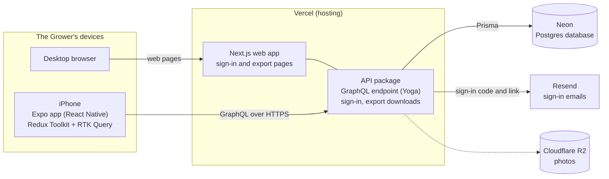

# Architecture

How the pieces of Dahlia Tracker fit together. Keep this current: any change that adds, removes, or moves a piece of the system updates this file in the same PR. Dashed lines are planned but not built yet.

## The pieces

| Piece           | What it is                                                                                                                              | Where it runs              |
| --------------- | --------------------------------------------------------------------------------------------------------------------------------------- | -------------------------- |
| Expo app        | The phone app for the Spring Count and everyday inventory, written in React Native. During development it runs inside the Expo Go app.  | The Grower's iPhone        |
| Next.js web app | The website: desktop pages for the Grower and, from M2, the Storefront for Friends.                                                     | Vercel                     |
| API package     | The one GraphQL API both apps call. It holds the domain rules. It is deployed as a route inside the Next.js app (ADR-0003).             | Vercel, inside the web app |
| Prisma          | The library the API uses to read and write the database, and to run migrations. Its schema and migrations live in the database package. | Inside the API             |
| Neon            | The hosted Postgres database that holds all the data.                                                                                   | Neon's cloud               |
| Resend          | The service that sends sign-in emails.                                                                                                  | Resend's cloud             |
| Cloudflare R2   | Photo storage, planned for M3.                                                                                                          | Cloudflare's cloud         |

## Environments

- **Production**: the Vercel deployment, the Grower's Neon database, and Resend. All three are free tiers.
- **Local development**: the web app and API run on the developer's machine, against Postgres in Docker. The Expo app runs in Expo Go and loads from the developer's machine. When the phone can't reach that machine over the home network, `npm run mobile:tunnel` serves the app through an ngrok tunnel and the API through a Cloudflare tunnel.
- **Tests and CI**: the API runs inside the test process, against a throwaway Postgres (Docker locally, a service container in GitHub Actions). Sign-in emails go to an in-memory outbox instead of Resend.

## Self-hosting (ADR-0002)

Each deployment serves one Grower. Another grower runs their own copy: their own Vercel project deployed from the public repo, their own Neon database, and their own Resend key. They connect these through environment variables in their Vercel project settings. Connection strings and keys are secrets: they are never committed, and no two deployments share a database.
